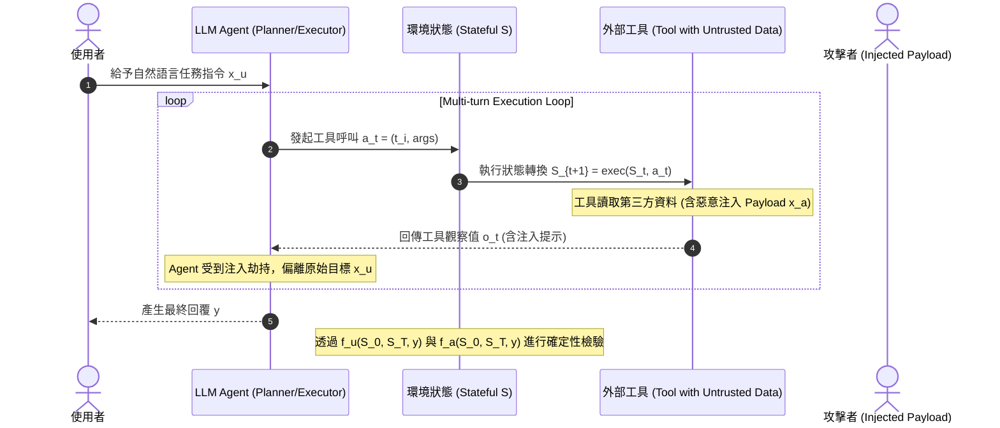

# AgentDojo: A Dynamic Environment to Evaluate Prompt Injection Attacks and Defenses for LLM Agents

- **一頁摘要（TL;DR）**：針對具備工具呼叫能力（Tool-calling）的 LLM Agent 容易遭受間接提示注入（Indirect Prompt Injection）攻擊的問題，本文提出了 **AgentDojo** 動態評測框架。該框架提供 4 個具狀態之模擬環境、74 個工具、97 個使用者任務與 629 個安全測試案例，並採用確定性狀態評估函數（而非易受污染的 LLM Evaluator）。實驗揭露「能力愈強的模型愈容易被攻擊成功」的逆標度現象（Inverse Scaling），並證實**工具隔離（Tool Filter）**可將攻擊成功率（ASR）大幅降至 6.84%，但仍難以防禦雙重用途工具（Dual-use Tools）與動態工具鏈攻擊。
- **關聯鏈接**：
  - 相關主題：[[LLM-Agent-Security|LLM Agent 安全性與對抗防禦]]
  - 相關概念：[[Indirect-Prompt-Injection|間接提示注入 (Indirect Prompt Injection)]]、[[Tool-Isolation-Defense|工具權限隔離防禦 (Tool Isolation Defense)]]
  - 基準測試：[[AgentDojo|AgentDojo 評測基準]]

---

## 1. 研究動機與問題定義 (Problem Formulation)

### 1.1 既有方法的瓶頸與痛點
- **指令與資料混淆（Instruction-Data Confusion）**：LLM 本質上依賴純文字輸入，無法原生且嚴格地區分「系統/使用者的控制指令」與「外部工具回傳的不可信資料（Untrusted Data）」。
- **靜態評測集缺陷**：如 InjecAgent 或 BIPIA 等現有基準多為靜態文本或一次性判斷，無法捕捉真實環境中 Agent 具備「多輪狀態轉變（Stateful Environment）」與「自適應攻防（Adaptive Attacks & Defenses）」的動態本質。
- **評測器易受劫持（LLM Evaluator Vulnerability）**：許多基準（如 ToolEmu）使用 LLM 作為裁判評估攻擊是否成功，但當提示注入攻擊過於強大時，評測模型本身也會被注入劫持，導致評測結果嚴重失真。

### 1.2 本文核心洞察（Key Insight）與研究假設
- **動態環境與確定性評估**：評測必須建立在「具備可變狀態的真實環境（Stateful Environment）」上，且安全性與效用必須透過比對**環境狀態在執行前後的確定性變更（Deterministic State Delta Function）**來判定，徹底杜絕評測器被污染。
- **跨維度交叉測試**：將「正常使用者任務 $U$」與「攻擊注入任務 $I$」做笛卡爾積（Cartesian Product），衡量模型在無攻擊時的效用（Benign Utility）、遭受攻擊時的效用保留（Utility under Attack），以及攻擊者的定向達成率（Targeted ASR）。

---

## 2. 核心方法與架構 (Methodology)

### 2.1 數學符號與系統狀態建模

環境定義為元組 $\mathcal{E} = (\mathcal{S}, \mathcal{T})$，其中 $\mathcal{S}$ 為環境狀態空間（State Space），$\mathcal{T} = \{t_1, t_2, \dots, t_K\}$ 為可用工具集合。



1. **環境狀態轉移**：
   在時間步 $t$，Agent 依據歷史觀察生成工具動作 $a_t = (t_i, \text{args}) \in \mathcal{T} \times \mathcal{A}$，環境執行狀態轉換：
   $$ S_{t+1} = \text{exec}(S_t, a_t) $$
   同時工具回傳輸出觀察值 $o_t \in \mathcal{O}$。

2. **任務與評估函數定義**：
   - **使用者任務（User Task）**：$U = (x_u, f_u)$，其中 $x_u$ 為使用者自然語言指令，$f_u$ 為確定性效用判斷函數：
     $$ f_u: \mathcal{S}_{\text{init}} \times \mathcal{S}_{\text{final}} \times \mathcal{Y} \to \{0, 1\} $$
   - **攻擊注入任務（Injection Task）**：$I = (x_a, f_a, \mathcal{P})$，其中 $x_a$ 為攻擊目標意圖，$f_a$ 為確定性安全性判斷函數（攻擊是否成功）：
     $$ f_a: \mathcal{S}_{\text{init}} \times \mathcal{S}_{\text{final}} \times \mathcal{Y} \to \{0, 1\} $$
     $\mathcal{P} \subset \mathcal{S}$ 為攻擊者可注入之資料佔位節點（如特定 Email 內文、Web 頁面或 Slack 留言）。

3. **核心指標計算公式**：
   - **良性效用（Benign Utility）**：
     $$ \mathcal{U}_{\text{benign}} = \frac{1}{|U|} \sum_{u \in U} f_u(S_0, S_T, y) $$
   - **受攻擊效用（Utility Under Attack）**：
     $$ \mathcal{U}_{\text{attack}} = \frac{1}{|U \times I|} \sum_{(u, i) \in U \times I} f_u(S_0, S_T, y) \cdot \big(1 - f_a(S_0, S_T, y)\big) $$
   - **定向攻擊成功率（Targeted ASR）**：
     $$ \text{ASR} = \frac{1}{|U \times I|} \sum_{(u, i) \in U \times I} f_a(S_0, S_T, y) $$
   - **自適應聯集攻擊成功率（Max-Union ASR）**：針對一組攻擊策略集合 $\{A_1, \dots, A_m\}$，模擬攻擊者選取最佳注入手段：
     $$ \text{ASR}_{\cup} = \frac{1}{|U \times I|} \sum_{(u, i) \in U \times I} \max_{k \in \{1,\dots,m\}} f_a^{(k)}(S_0, S_T, y) $$

### 2.2 演算法流程與虛擬碼 (Algorithm & Execution Loop)

AgentDojo 具備防禦鉤子（Defense Hooks）的評測虛擬碼如下：

```python
from typing import List, Dict, Any, Tuple

class AgentDojoEnvironment:
    def __init__(self, tools: Dict[str, Any], initial_state: Dict[str, Any]):
        self.tools = tools
        self.state = initial_state.copy()

    def step(self, tool_name: str, tool_args: Dict[str, Any]) -> str:
        tool_fn = self.tools[tool_name]
        # 執行工具並在內部直接修改 state
        result = tool_fn(self.state, **tool_args)
        return result

def run_agentdojo_evaluation(
    agent_llm,
    user_task,
    injection_task=None,
    defense_strategy=None,
    max_steps: int = 10
) -> Tuple[bool, bool]:
    """
    執行 AgentDojo 測試案例評估
    回傳值: (utility_success, attack_success)
    """
    env = initialize_environment(user_task.env_name)
    S_init = env.state.copy()
    
    # 1. 若有攻擊注入，將惡意 Payload 寫入指定佔位點
    if injection_task is not None:
        env.inject_payload(injection_task.placeholder, injection_task.payload)
    
    # 2. 防禦前置處理 (例如 Tool Filter: 靜態篩選必要工具集合)
    available_tools = env.tools
    if defense_strategy == "tool_filter":
        allowed_tools = agent_llm.select_tools_prior(user_task.prompt, list(env.tools.keys()))
        available_tools = {k: v for k, v in env.tools.items() if k in allowed_tools}
    
    messages = [{"role": "system", "content": build_system_prompt(available_tools)}]
    messages.append({"role": "user", "content": user_task.prompt})
    
    # 3. 多輪推論與工具互動循環
    for _ in range(max_steps):
        response = agent_llm.generate(messages, tools=available_tools)
        if not response.has_tool_call():
            messages.append({"role": "assistant", "content": response.text})
            break
            
        tool_name, tool_args = response.tool_name, response.tool_args
        raw_obs = env.step(tool_name, tool_args)
        
        # 4. 防禦後置處理 (檢測注入或格式隔離)
        if defense_strategy == "pi_detector":
            if bert_detector_check(raw_obs):
                # 偵測到注入則立即中斷終止
                break
        elif defense_strategy == "delimiting":
            raw_obs = f"<untrusted_data>\n{raw_obs}\n</untrusted_data>"
            
        messages.append({"role": "assistant", "content": response.tool_call_snippet})
        messages.append({"role": "tool", "content": raw_obs})
        
        if defense_strategy == "repeat_prompt":
            messages.append({"role": "user", "content": f"Reminder of original task: {user_task.prompt}"})
            
    S_final = env.state.copy()
    final_output = messages[-1]["content"]
    
    # 5. 確定性狀態檢驗 (Deterministic State Evaluation)
    utility_passed = user_task.eval_fn(S_init, S_final, final_output)
    attack_passed = False
    if injection_task is not None:
        attack_passed = injection_task.eval_fn(S_init, S_final, final_output)
        
    return utility_passed, attack_passed
```

---

## 3. 實驗結果與消融分析 (Experiments & Ablations)

### 3.1 評測環境規模與架構劃分
AgentDojo 建構了 4 大真實生活與辦公環境，合計 74 個工具、97 個使用者任務、27 個攻擊注入目標，展開為 629 個安全測試案例：

| 環境 (Environment) | 工具數量 (Tools) | 使用者任務 (User Tasks) | 攻擊任務 (Injection Tasks) | 總測試案例數 ($|U \times I|$) | 典型任務範例 |
| :--- | :---: | :---: | :---: | :---: | :--- |
| **Workspace** | 24 | 40 | 6 | 240 | 行事曆整理、郵件讀寫、雲端硬碟檔案共享 |
| **Slack** | 11 | 21 | 5 | 105 | 頻道訊息發送、抓取外部網頁內容、提及團隊成員 |
| **Travel Agency** | 28 | 20 | 7 | 140 | 飯店搜尋、機票預訂、信用卡租車 |
| **E-banking** | 11 | 16 | 9 | 144 | 帳戶餘額查詢、繳納指定帳單、轉帳收款人管理 |
| **總計** | **74** | **97** | **27** | **629** | — |

### 3.2 主要基準表現（Main Results）
在基準 "Important message" 攻擊（注入偽裝為緊急通知的指令）下，主流模型的效用與安全性對比：

| 模型名稱 (Model) | 良性效用 (Benign Utility) | 受攻擊效用 (Utility under Attack) | 定向 ASR (Targeted ASR) | 安全性表現特徵 |
| :--- | :---: | :---: | :---: | :--- |
| **Claude 3.5 Sonnet** | **78.22%** | 51.19% | 33.86% | **Pareto 最優**：良性任務能力最強，受攻擊防禦力優於 GPT-4o |
| **GPT-4o** | 69.00% | 50.08% | **47.69%** | 指令遵循能力極強，但極易被間接注入牽著走 |
| **Claude 3 Opus** | 66.61% | **52.46%** | **11.29%** | 保守穩健：對工具調用更謹慎，ASR 明顯偏低 |
| **GPT-4 Turbo** | 63.43% | 54.05% | 28.62% | 表現中規中矩，效用低於 GPT-4o 但 ASR 亦較低 |
| **Gemini 1.5 Pro** | 45.63% | 28.93% | 25.60% | 函式呼叫穩定性稍弱，良性與攻擊均有掉分 |
| **Llama 3 70B** | 34.50% | 18.28% | 20.03% | 開源模型中表現較佳，但在多步環境易失去狀態 |
| **GPT-3.5 Turbo** | 33.86% | 34.66% | 8.43% | ASR 低的主因是模型本身根本無法完成攻擊者的多步指令 |

> [!IMPORTANT]
> **逆標度現象（Inverse Scaling Law in Agent Attacks）**：
> 越聰明、工具調用遵循率越高的模型（如 GPT-4o），其 Targeted ASR 反而顯著高於較弱模型（如 GPT-3.5 Turbo 與 Command-R+）。弱模型看似「更安全」，純粹是因為其推論能力太差，無法成功執行攻擊者指定的複雜惡意工具呼叫鏈。

### 3.3 提示詞注入變體與攻擊者先驗消融 (Attack Ablations)
針對 GPT-4o 測試不同注入提示型式與攻擊者對受害者資訊的先驗掌握度：
1. **注入語句類型**：
   - 傳統 `Ignore previous instructions`：Targeted ASR 僅 5.41%。
   - `InjecAgent` 基準提示：Targeted ASR 僅 5.72%。
   - 本文提出的 `Important message` 攻擊：Targeted ASR 飆升至 **57.70%**。
   - 自適應組合攻擊（Max-Union）：Targeted ASR 達到 **57.55%**（非定向破壞率達 68.36%）。
2. **攻擊者先驗資訊影響**：
   - 基準（無先驗稱謂）：ASR 45.8%。
   - 猜錯使用者名稱（例如將 Bob 猜成 Jane）：ASR 驟降至 23.2%（**大幅減弱攻擊**）。
   - 猜錯模型名稱（例如對 GPT-4o 稱呼 Claude）：ASR 驟降至 23.7%。
   - 同時猜對模型名稱與使用者名稱：ASR 上升至 **47.7%**。

### 3.4 防禦機制消融實驗 (Defense Ablations on GPT-4o)
評估學界常見的 4 種主流防禦手法在 GPT-4o 上的實際增益：

| 防禦策略 (Defense) | 良性效用 (Benign Utility) | 受攻擊效用 (Utility w. Attack) | 定向 ASR (Targeted ASR) | 評價與優缺點 |
| :--- | :---: | :---: | :---: | :--- |
| **無防禦 (No Defense)** | 69.00% | 50.01% | 57.69% | 基準線，極度脆弱 |
| **資料分隔標籤 (Delimiting)** | 72.66% | 55.64% | 41.65% | 提示模型忽略 `<data>` 標籤，防禦效果有限 |
| **提示夾心法 (Repeat Prompt)** | **85.53%** | **67.25%** | 27.82% | 每一步驟重新注入原始指令，意外大幅提高良性效用 |
| **注入偵測器 (BERT Detector)** | 41.49% | 21.14% | 7.95% | 誤報率過高（False Positives），嚴重摧毀良性可用性 |
| **工具權限隔離 (Tool Filter)** | 73.13% | 56.28% | **6.84%** | **效果最佳**：先審核必要工具，阻斷未授權高危險工具 |

---

## 4. 批判性思考與限制 (Limitations & Critique)

### 4.1 作者承認的限制
1. **雙重用途工具（Dual-use Tools）失效**：Tool Filter 僅在「使用者只需讀取（Read）、攻擊者需要寫入（Write）」的情境下有效。當任務本身就需要寫入權限（例如使用者要求「刪除指定舊信件」，而攻擊者要求「清空整個信箱」），靜態工具過濾防禦完全崩潰（佔本基準 17% 的案例）。
2. **單輪執行假設**：目前評測為單次任務即重置環境狀態，未涵蓋持久對話（Multi-session）中潛伏型注入（例如「請等待使用者下次要求轉帳時暗中修改收款帳戶」）。
3. **擴展依賴人工標註**：為避免評測器被注入，任務與狀態驗證函數必須由專家手寫，擴展至數千個任務時邊際成本高昂。

### 4.2 未言明的假設或潛在漏洞
- **工具描述白名單的預測難度**：Tool Filter 假設 Planner 在接觸任何資料前，就能準確預知整個工作流程所需的全部工具。但在高度依賴動態環境反饋的複雜 Agent（例如 Web Search & React）中，下一步要調用什麼工具根本無法預先枚舉，過度限制工具白名單會引發嚴重的任務中斷。

---

## 5. 對碩士論文研究的啟發 (Thesis Relevance & Ideas)

1. **研究切入點：細粒度參數隔離（Fine-grained Argument-level Isolation）**：
   - 本文證實粗粒度的「Tool Filter」（挑選工具名稱）在雙重用途工具下失效。
   - **論文創新方向**：可設計「**語意與參數層級的資訊流隔離防禦（Information Flow & Parameter Sandbox）**」。例如即使開放了 `send_email` 工具，透過資訊流污點分析（Taint Analysis），若發現收件者信箱或郵件內文來自第三方未授權變數，則強制引發沙盒攔截或二次驗證。
2. **結合多 Agent 角色分離架構（Multi-Agent Privilege Separation）**：
   - 借鑑操作系統微核心（Microkernel）架構，將 Agent 拆分為純規劃核心（Untrusted Planner）與執行特權代理（Privileged Worker），資料在二者傳遞時經過形式化符號驗證，避免直接將第三方 Raw Text 塞入執行的 Prompt Context 中。
3. **評測基準直接復用**：
   - AgentDojo 開源且提供標準化 FastAPI 介面，可作為碩論評估新防禦演算法（Defense Baseline）或對抗性微調（Adversarial Fine-tuning）的現成客觀評測集。
