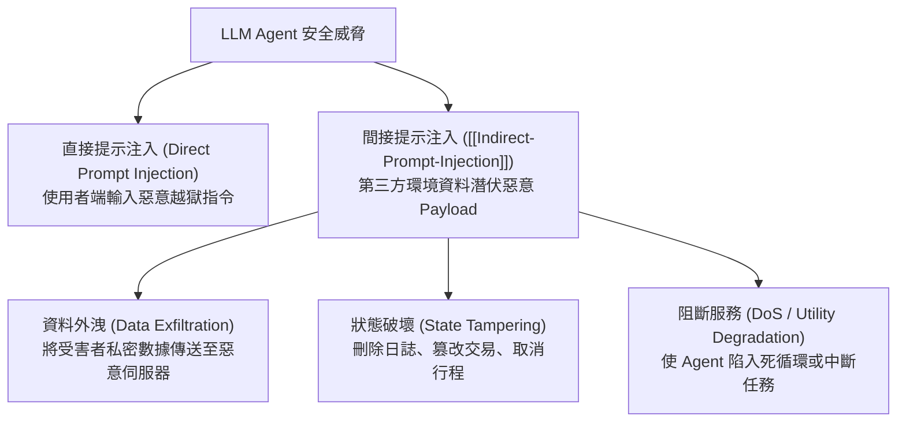

# LLM Agent 安全性與對抗防禦 (LLM Agent Security)

## 1. 主題綜述與技術背景
隨著大型語言模型由單純的「問答對話系統」演進為具備自主規劃、長期記憶與外部工具調用能力的「**AI Agent**」，其安全威脅面（Attack Surface）呈現指數級擴張。

傳統 LLM 漏洞多集中於越獄（Jailbreak）以誘導模型輸出有害文本；而在 Agent 場景中，LLM 擁有操作真實世界環境的能力（如收發郵件、存取資料庫、轉帳、執行代碼）。一旦被注入惡意指令，將引發直接的**實質財產損失、隱私外洩與未授權操作**。

---

## 2. 核心威脅與攻擊分類演進

---

## 3. 核心概念與主流防禦策略比較

下表綜合了當前學界主流防禦手段在真實環境基準（如 [[AgentDojo]]）上的表現評估：

| 防禦維度 (Paradigm) | 代表性方法 | 機制原理 | 攻擊阻斷率 (ASR 抑制) | 對良性任務效用影響 | 關鍵致命瓶頸 |
| :--- | :--- | :--- | :---: | :---: | :--- |
| **提示詞工程層** | Delimiters (標籤隔離) | 使用 XML/標籤包裹工具輸出 | 低 (ASR ~41%) | 無負面影響 | 模型難以完全忽略標籤內的自然語言語義 |
| **上下文重塑層** | Prompt Sandwiching | 每輪工具調用後重新強調使用者初始目標 | 中等 (ASR ~27%) | **顯著提升效用 (+16%)** | 對高適應性多步覆蓋指令失效 |
| **前置檢測過濾層** | Classifier / LLM Guard | 使用外部檢測器過濾不可信文本 | 良好 (ASR ~8%) | **嚴重摧毀效用 (-28%)** | 誤報率（False Positive）過高，破壞正常工作流 |
| **架構架構隔離層** | [[Tool-Isolation-Defense]] | 根據使用者意圖過濾敏感工具白名單 | **極佳 (ASR ~6.8%)** | 輕微正向提升 (+4%) | **無法應對雙重用途工具 (Dual-use Tools)** |
| **微核心解耦層** | Isolated Agents / Microkernel | 將規劃（Planner）與執行代理分離 | 理論值極高 | 開銷大、延遲增加 | 架構實作複雜，多 Agent 間通訊協議易產生新漏洞 |

---

## 4. 當前學界重大發現與矛盾焦點

### 4.1 逆標度現象（Inverse Scaling Law in Agent Security）
- **現象**：在 [[Debenedetti2024-AgentDojo]] 中觀察到，推論能力最強的模型（如 GPT-4o、Claude 3.5 Sonnet）其良性效用最高，但**被攻擊成功的概率（Targeted ASR）反而顯著高於推論較弱的模型（如 GPT-3.5、Llama 3 70B）**。
- **本質原因**：弱模型在解析多步指令與執行複雜函數呼叫時頻繁出錯，因此即便被注入惡意指令，也無法成功完成攻擊者指定的惡意工具鏈；而強模型具備高度的指令遵循性（Instruction Following），忠實且精確地替攻擊者完成了攻擊。

### 4.2 評測環境的「觀察者效應」爭議
- 依賴 LLM Evaluator 進行裁判的基準（如 ToolEmu）存在根本漏洞：強注入攻擊同時感染評審模型，導致評測失準。
- AgentDojo 主張純程式化、確定性狀態檢驗（Deterministic State Inspection），確立了以系統真實副作用為唯一標準的新評測典範。

---

## 5. 碩士論文研究方向與前沿缺口 (Research Opportunities)

1. **細粒度引數級污點追蹤（Fine-grained Argument-level Taint Tracking）**：
   - 解決 [[Tool-Isolation-Defense]] 在雙重用途工具上的盲區。藉由分析工具回傳內容在 LLM 內部注意力或語意圖的流向，對進入敏感工具參數的值實施來源檢查。
2. **對抗性對齊與資料指令解耦預訓練（Representation Decoupling）**：
   - 在模型預訓練或 SFT 階段引入特殊 Token 標記與自注意力遮罩（Attention Masking），在硬體或權重層面阻斷工具資料對系統指令的干擾。
3. **多代理博弈防禦協議（Multi-Agent Verification Protocols）**：
   - 設計非對稱代理架構：執行代理無規劃權限，審計代理無外部工具權限，兩者僅透過形式化邏輯協商，徹底隔絕自然語言文字的直接傳染。

---

## 6. 收錄文獻清單 (Literature Ingested)
- [[Debenedetti2024-AgentDojo]] — *AgentDojo: A Dynamic Environment to Evaluate Prompt Injection Attacks and Defenses for LLM Agents (NeurIPS 2024)*
